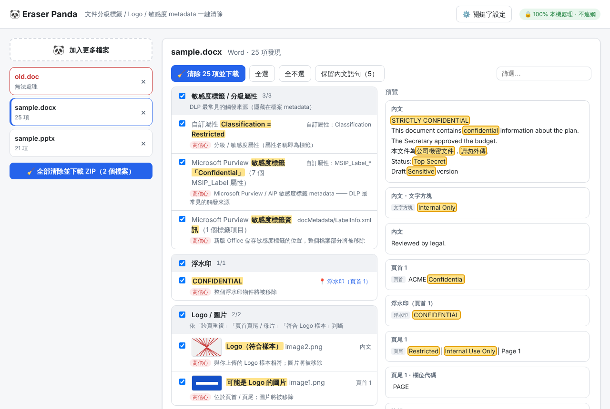
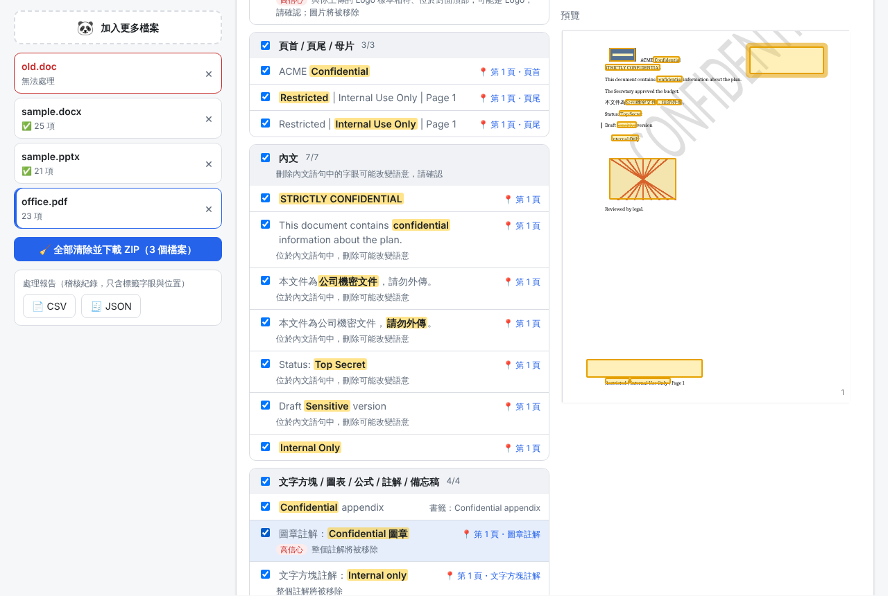

# Eraser Panda 🐼

**單一 HTML、100% 本機執行** 的文件去識別化小工具：找出並移除 PDF / Word / Excel / PowerPoint 中的
分級標籤字眼（Confidential、Sensitive、Secret、機密…）、公司 Logo、敏感度標籤 metadata（Microsoft Purview `MSIP_Label_*`）、
作者 / 公司等身分資訊，讓「已確認可以外傳」的文件不再觸發 DLP / 上傳閘道誤報。原檔不動，輸出 `原檔名_clean.副檔名`。

> ⚠️ 本工具 **不會** 判斷文件能不能外流 —— 那是使用者的責任。請在取得授權的前提下使用，並保留處理報告。
> 詳見 [需求與風險](docs/REQUIREMENTS.md#3-風險與盲點請正視)。




## 使用方式
1. 下載 [`release/EraserPanda.html`](release/EraserPanda.html)，用 Chrome / Edge 直接開啟（不需安裝、不需網路，可放在隨身碟）。
2. 把文件拖進視窗（可一次多個）。
3. 檢視發現清單：點 📍 在預覽中看位置；取消勾選要保留的例外（或按「保留內文語句」）。
4. 按「🧹 清除並下載」→ 得到 `*_clean.*`。多檔可一次打包 ZIP。
5. 需要稽核紀錄時，下載處理報告（CSV / JSON，含原檔與輸出的 SHA-256，只列標籤字眼與位置）。

## 會處理什麼
| 類別 | Word | Excel | PowerPoint | PDF |
|---|---|---|---|---|
| 標籤字眼（內文、頁首頁尾、文字方塊、註解、備忘稿、圖表…） | ✅ 含跨 run、追蹤修訂、欄位代碼 | ✅ 含公式字串、頁首頁尾代碼、樞紐快取 | ✅ 含母片 / 版面配置 | ✅ 真刪除字形並補位，版面不動 |
| 浮水印 | ✅ 文字 / 圖片浮水印 | — | — | ✅ Artifact / 斜向文字 / 註解浮水印 |
| Logo | ✅ 頁首頁尾 | ✅ 跨表重複、頁首頁尾 `&G` | ✅ 母片、跨頁重複 | ✅ 跨頁重複、頁首頁尾 |
| 敏感度標籤 metadata | ✅ `MSIP_Label_*`、`LabelInfo.xml`、customXml | ✅ | ✅ | ✅ Info、XMP |
| 身分資訊 | ✅ 作者、公司、註解 / 修訂作者、縮圖 | ✅ | ✅ | ✅ 作者、Company |
| 其他 | 內嵌 Office 檔遞迴處理 | | 圖表內嵌活頁簿 | 註解 / 圖章、書籤、附件、增量更新殘留 |

內建中 / 英 / 日 / 韓分級字眼，可在「⚙️ 關鍵字設定」加入公司名稱、專案代號、正規表示式，以及**上傳 Logo 樣本**做圖像比對；設定可匯出給同事共用。

## 為什麼可以信任
- **檔案不離開電腦**：頁面以 CSP `connect-src 'none'` 封鎖所有網路連線，所有程式碼內嵌在單一 HTML；自動化測試驗證零網路請求。
- **真刪除**：PDF 不是蓋黑框，而是從內容串流移除字形；被刪除的物件、舊版本殘留會被垃圾回收。
- **雙重驗證**：清除後重新掃描 + 對輸出檔原始位元組（解壓每個串流 / zip part）再搜尋一次，顯示「殘留 0」。

## 已知限制
- 舊版二進位 `.doc/.xls/.ppt`、加密檔（含 Purview / RMS 加密、PDF 權限密碼）不處理 —— 會告訴你如何轉換。
- 掃描型 PDF（圖片）與「轉成外框」的文字不是文字，無法偵測；EMF / WMF 向量 Logo 只能依位置判斷。
- Excel 工作表名稱只提示、不自動改名（會破壞公式參照）。

## 文件
- [需求規格](docs/REQUIREMENTS.md)・[實作計畫與進度](docs/PLAN.md)・[接手指南](AGENTS.md)

## 開發
```bash
npm ci
npm run dev       # 開發
npm run check     # typecheck + 單元測試 + 打包
npm run e2e       # 對打包後的 HTML 跑 Playwright（file://、零網路）
npm run release   # 產出 release/EraserPanda.html
```
